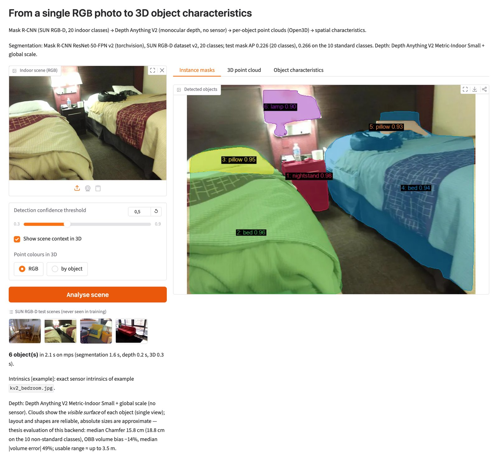
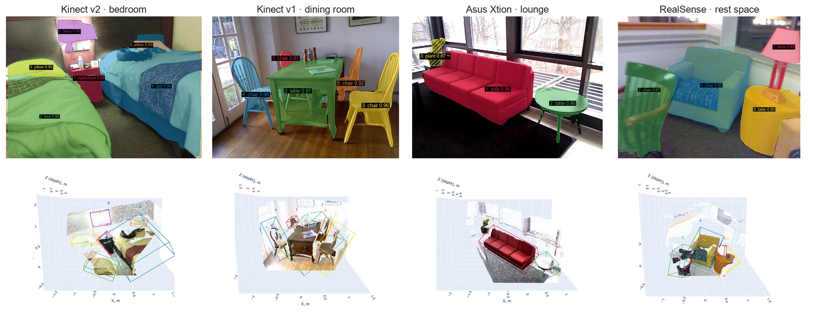
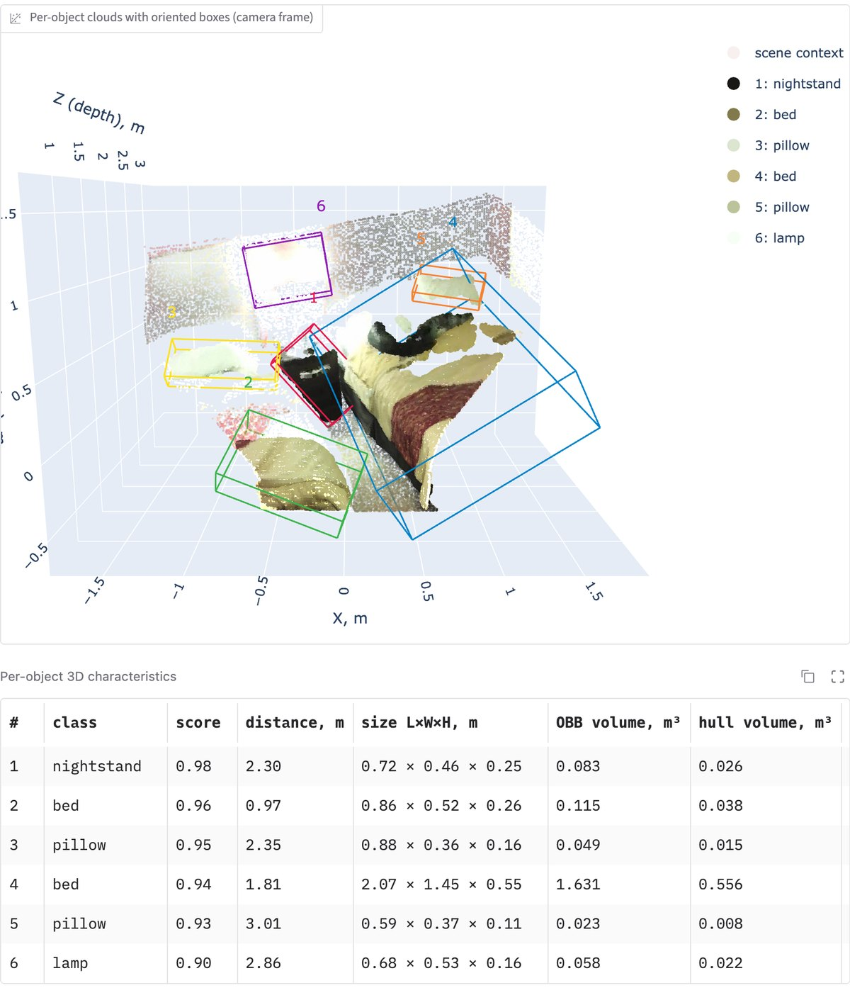
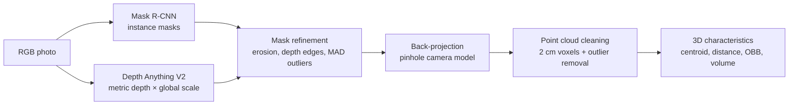

# From a single RGB photo to 3D objects: two-stage Mask R-CNN on SUN RGB-D


Master's thesis project *"Object segmentation using a two-stage Mask R-CNN model"*
(Polina Sushko, State University of Trade and Economics, Kyiv, 2026).

A Mask R-CNN model finds indoor objects (furniture and 10 more classes) in an RGB
photo. Its instance masks are combined with depth – measured by a sensor or
predicted from the photo alone by Depth Anything V2 – and every object is
back-projected into a point cloud. The point cloud gives the object's position,
distance to the camera, size and volume. A Gradio web app runs the whole
pipeline on one photo, without a depth sensor.

<p align="center">
  
</p>

**Contents:** [Try the demo](#try-the-demo) · [Examples](#examples) ·
[How it works](#how-it-works) · [Results](#results) ·
[Repository layout](#repository-layout) · [Reproducing the experiments](#reproducing-the-experiments) ·
[Thesis and publication](#thesis-and-publication)

## Try the demo

You need Python 3.11 and about 2 GB of free disk space. A GPU is not required:
the app uses CUDA or Apple-silicon MPS when available and otherwise runs on the CPU.

```bash
git clone https://github.com/PolinaSushko/Object-segmentation-using-a-two-stage-Mask-R-CNN-model.git
cd Object-segmentation-using-a-two-stage-Mask-R-CNN-model

python3.11 -m venv .venv
source .venv/bin/activate            # Windows: .venv\Scripts\activate
pip install -r app/requirements.txt

python app/app.py
```

Then open <http://127.0.0.1:7860> in the browser.

The first start downloads two models:
- the Mask R-CNN weights (176 MB) from the [v1.0 release](https://github.com/PolinaSushko/Object-segmentation-using-a-two-stage-Mask-R-CNN-model/releases/tag/v1.0) into `app/weights/`;
- Depth Anything V2 from Hugging Face (~100 MB).

Later starts take a few seconds.

**In the app:**

1. Click one of the four example scenes under the button, or upload your own photo of a room.
2. Press **Analyse scene**.
3. Switch between the tabs:
   - **Instance masks** – detected objects with their class and confidence;
   - **3D point cloud** – an interactive scene: drag to rotate, scroll to zoom. Every object is drawn as a coloured point cloud with its oriented bounding box;
   - **Object characteristics** – distance, size and volume of every object.

A photo is processed in about 0.5 s on an Apple M4 Pro (MPS) and about 1.9 s on its CPU.

<details>
<summary><b>Notes on your own photos</b></summary>

- Camera parameters come from the 35 mm-equivalent focal length in the EXIF data.
  Without EXIF, a typical Kinect-like field of view is assumed. The status line
  tells which source was used. A wrong focal length stretches the whole scene.
- Large photos are resized to a 640 px long side; EXIF rotation is applied.
- Depth from one photo is reliable up to about 3.5 m. Objects farther away are
  marked with ≈ in the table and drawn with dashed boxes.
- Distances and linear sizes are approximate; volumes describe only the visible
  surface of an object.
- The model knows 20 classes: bed, chair, sofa, table, desk, toilet, dresser,
  nightstand, bookshelf, bathtub, cabinet, pillow, display, shelf, lamp,
  garbage bin, computer, keyboard, sink, plant.

Options (depth backends, local weights, Hugging Face Spaces layout) are described
in [`app/README.md`](app/README.md).
</details>

## Examples

The four bundled scenes come from the test split, one per sensor, and were never
seen in training. Top row: instance masks. Bottom row: the same objects in 3D,
reconstructed from monocular depth only.

<p align="center">
  
</p>

For the bedroom, the third tab lists every object. Size L×W×H is the extent of
the oriented bounding box; the box volume and the convex-hull volume both
describe the visible surface.

<p align="center">
  
</p>

The same scene with ground-truth masks and sensor depth puts the large bed at
1.72 m and the nightstand at 2.45 m. The app, working from the photo alone,
gives 1.81 m and 2.30 m.

## How it works



- **Segmentation.** Mask R-CNN with an FPN backbone, fine-tuned from COCO on SUN RGB-D.
- **Depth.** Depth Anything V2 Metric-Indoor Small with one global scale factor (0.857) fitted on validation images.
- **Mask refinement.** It removes mask pixels whose depth belongs to the background. Without it, clouds get "curtains" of points stretching to the wall; the refinement shrinks the median reference volume 3.2×.
- **One code base.** The same code (`utils/pointcloud.py`) runs in the notebooks and in the app, so the measured accuracy describes the app as well.

## Results

**Segmentation** – dataset v2, test split of 1,287 images with 5,043 instances of
the 10 standard SUN RGB-D classes. The model is selected by validation mask AP.

| Model | val mask AP | test mask AP [95% CI] | AP50 | T4 ms/img |
|---|---|---|---|---|
| **Mask R-CNN, Detectron2 R101-FPN, 20-class training** (selected) | **0.257** | **0.266** [0.246, 0.302] | 0.427 | 224 |
| Mask R-CNN, Detectron2 R101-FPN | 0.248 | 0.263 [0.243, 0.297] | 0.431 | — |
| Mask R-CNN, torchvision R50-FPN v2, 20-class training (demo model) | 0.242 | 0.266 [0.247, 0.300] | 0.430 | 230 |
| Mask R-CNN, torchvision R50-FPN v2 | 0.245 | 0.261 [0.242, 0.294] | 0.426 | 231 |
| Mask R-CNN, Detectron2 R50-FPN | 0.244 | 0.247 [0.226, 0.283] | 0.405 | 183 |
| YOLOv8s-seg | 0.241 | 0.243 [0.222, 0.277] | 0.391 | 22 |
| SAM ViT-B + ground-truth box prompts¹ | — | 0.398 | 0.753 | — |

¹ Class-agnostic, with ground-truth boxes as prompts. It is an upper bound for mask
quality under perfect detection and is not directly comparable.

Main findings:
- **Selected model vs YOLOv8s-seg.** The selected model is better than YOLOv8s-seg
  (paired bootstrap ΔAP = +0.024 [0.002, 0.045], p = 0.03). It finds 52% of the
  objects versus 33%, but is about 10× slower.
- **Mask R-CNN variants.** They are statistically equal to each other. For example,
  Detectron2 vs torchvision gives ΔAP = +0.0002, p = 0.98, so the demo uses the
  pure-PyTorch torchvision model.
- **Where AP is lost.** TIDE error analysis shows that localization (ΔAP 6.1) and
  background detections (5.8) cost the most.
- **Annotation gaps.** A visual audit found that at least 36 of 40 confident
  "background" detections are real furniture missing from the annotation.

**From masks to 3D** – median over 2,580 matched test objects. The reference is the
ground-truth mask with sensor depth.

| Mask + depth source | Chamfer distance | OBB volume bias |
|---|---|---|
| predicted mask + sensor depth | 0.8 cm | −2% |
| predicted mask + relative depth, per-image alignment (oracle) | 8.9 cm | −43% |
| predicted mask + relative depth, one global alignment | 25.0 cm | −61% |
| **predicted mask + metric Small × global scale** (demo) | **15.2 cm** | **−12%** |
| predicted mask + metric Base × global scale | 13.2 cm | −10% |

The table supports four conclusions:
- **Segmentation errors** are almost free in 3D; the error comes from depth.
- **Distance range.** Up to 3.5 m the demo backend stays within about 20 cm median
  Chamfer distance.
- **Farther objects.** Beyond 3.5 m both metric models beat even the per-image
  oracle alignment.
- **What to trust.** Distances and linear sizes are usable; absolute volumes are
  not (median |error| 45–50%).

Over all 20 classes (3,586 objects) the demo backend gives 15.8 cm.

## Repository layout

| Path | Content |
|---|---|
| `app/` | Gradio web demo: `app.py` (UI), `pipeline.py` (inference), `export_weights.py`, bundled examples — see [`app/README.md`](app/README.md) |
| `utils/sunrgbd.py` | SUN RGB-D utilities: scene discovery, depth decoding, per-scene intrinsics, annotation parsing, class-name normalization, polygon clipping, leak-free scene grouping, back-projection |
| `utils/prepare_dataset.py` | CLI: polygons → COCO, stratified group split, leak check, dataset version file |
| `utils/pack_for_colab.py` | packs images and depth of the selected splits into one zip for Colab |
| `utils/evaluate_predictions.py` | the single evaluator for every model: COCO AP, per-class AP, P/R/F1, confusion matrix, mean matched IoU (`--agnostic` for SAM) |
| `utils/error_analysis.py` | TIDE error decomposition, bootstrap CIs, paired tests, galleries |
| `utils/coco_to_yolo.py` | COCO splits → YOLO-seg format |
| `utils/sam_gt_boxes.py` | SAM zero-shot baseline with ground-truth box prompts |
| `utils/pointcloud.py` | the shared point-cloud pipeline: mask refinement, back-projection, voxel + outlier filtering, 3D metrics, Chamfer distance |
| `notebooks/01_data_preparation.ipynb` | dataset overview, depth decoding, annotation parsing, clipping, leak-free grouping, split tables |
| `notebooks/01b_class_analysis.ipynb` | class vocabulary, name normalization, extended class configurations |
| `notebooks/02–04_*.ipynb` | training on Colab: Mask R-CNN (torchvision), Mask R-CNN (Detectron2), YOLOv8s-seg |
| `notebooks/05_pointclouds_sensor.ipynb` | masks + sensor depth → point clouds → 3D object metrics |
| `notebooks/06_monocular_depth.ipynb` | monocular depth: scale alignment methods, metric models |
| `notebooks/07_eval3d_mono_vs_sensor.ipynb` | 3D reconstruction from monocular vs sensor depth |
| `notebooks/08_eval3d_pred_masks.ipynb` | end-to-end 3D with predicted masks and six depth backends |
| `notebooks/09_error_analysis.ipynb` | error analysis of the selected model |
| `notebooks/10_model_comparison.ipynb` | final comparison, significance tests, training curves, qualitative examples |
| `notebooks/outputs/` | generated splits, tables and figures |
| `docs/images/` | images of this README |

## Reproducing the experiments

**Data.** SUN RGB-D (10,335 RGB-D frames from Kinect v1/v2, Asus Xtion and Intel
RealSense) is not included. Download it from the
[official page](https://rgbd.cs.princeton.edu/) and pass its folder as `--root`.
File paths inside the COCO files are relative to the dataset root.

The reported results use dataset v2:

- **Classes:** the standard 10 SUN RGB-D classes (bed, chair, sofa, table, desk,
  toilet, dresser, nightstand, bookshelf, bathtub). `min400` (20 classes, every
  class with ≥ 400 instances) is the extended configuration.
- **Masks:** polygons are clipped to the image (Sutherland–Hodgman). Compound or
  misspelled raw names (roundtable, loveseat, tabel, …) are mapped to their class
  (`notebooks/outputs/class_analysis/name_recovery_v2.csv`).
- **Leak-free split:** frames are grouped before splitting – SUN3D by site,
  timestamped frames by capture session across sensors, Kinect v1 near-duplicates
  by feature matching. The groups are then split 70/15/15, stratified by class
  and sensor (seed 42). `notebooks/outputs/splits/leak_check.txt` documents zero
  leaks.

**Steps.** Local environment: Python 3.11, `pip install -r notebooks/requirements.txt`
(PyTorch for notebook 06 and SAM is listed there).

```bash
# 1. COCO annotations + leak-free split (std10), then the 20-class configuration
python utils/prepare_dataset.py --root /path/to/SUNRGBD --out notebooks/outputs \
    --classes standard10
python utils/prepare_dataset.py --coco notebooks/outputs/sunrgbd_instances_all.json \
    --out notebooks/outputs --min-instances 400 --splits-name splits_min400 \
    --base-assignment notebooks/outputs/splits/split_assignment.csv

# 2. archive for Colab (upload it to Google Drive)
python utils/pack_for_colab.py --root /path/to/SUNRGBD \
    --splits notebooks/outputs/splits notebooks/outputs/splits_min400 --out sunrgbd_data.zip
```

3. **Train on Google Colab (T4).** Use notebooks 02 (torchvision), 03 (Detectron2,
   `BACKBONE` switch) and 04 (YOLOv8s-seg), and set `DRIVE_DIR` to your Drive folder.
   Training resumes automatically after a session drop. Every run folder
   (`vkr_runs/v2_*`) receives `val_predictions.json`, `test_predictions.json`,
   `timing.json` and logs.
4. **Compare the models.** Download the run folders to `~/Downloads/` (or set
   `VKR_RUNS_ROOT`) and run notebooks 10 and 09 locally.
5. **3D part.** Run notebook 06 first: it writes the monocular depth maps of the
   test split. Then run notebooks 05, 07 and 08.
6. **Demo weights.** Convert a trained checkpoint into the weights file of the demo:
   `python app/export_weights.py <best.pth> app/weights/maskrcnn_min400.pt`.

Any predictions file can be scored with the shared evaluator:

```bash
python utils/evaluate_predictions.py --gt notebooks/outputs/splits/instances_test.json \
    --pred test_predictions.json --out eval_dir --name my_model
```

## Acknowledgements

The project builds on these resources; please respect their licenses:
- data: [SUN RGB-D](https://rgbd.cs.princeton.edu/) (the bundled example photos come from it);
- segmentation: [Detectron2](https://github.com/facebookresearch/detectron2), [torchvision](https://github.com/pytorch/vision), [Ultralytics YOLOv8](https://github.com/ultralytics/ultralytics), [Segment Anything](https://github.com/facebookresearch/segment-anything);
- depth: [Depth Anything V2](https://github.com/DepthAnything/Depth-Anything-V2);
- 3D and the web app: [Open3D](https://www.open3d.org/), [Gradio](https://www.gradio.app/).
